# E2E 5G Drive-Test KPI Analyzer

[](https://github.com/Shaibu-github/5g-drive-test-kpi-analyzer/actions/workflows/tests.yml)
[](https://colab.research.google.com/github/Shaibu-github/5g-drive-test-kpi-analyzer/blob/main/drive_test_analysis.ipynb)

An end-to-end Python pipeline that turns raw drive-test logs into engineering findings: data cleaning, KPI statistics, serving-cell change (handover) analysis, a study of where ping-pong happens, maps, throughput prediction and an HTML dashboard.

**[Open the live dashboard](https://shaibu-github.github.io/5g-drive-test-kpi-analyzer/)** - one page for all drives and one report per drive.

[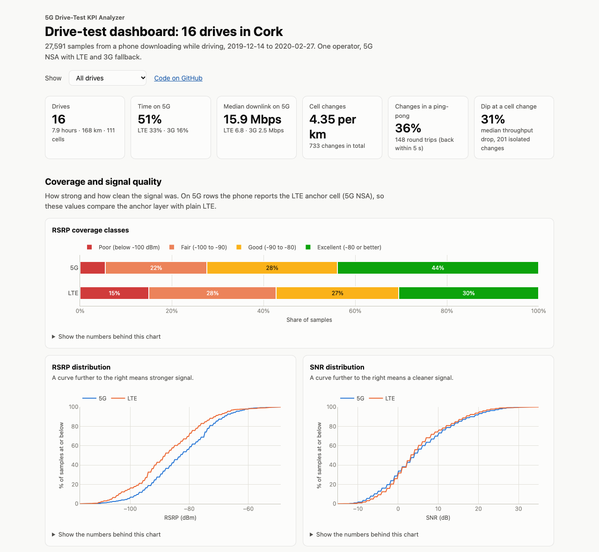](https://shaibu-github.github.io/5g-drive-test-kpi-analyzer/)

The data is real: 16 drive tests on a commercial network in Cork, Ireland, with 5G (NSA), LTE and 3G. That is 27,591 one-second samples, 7.9 hours and 168 km of driving.

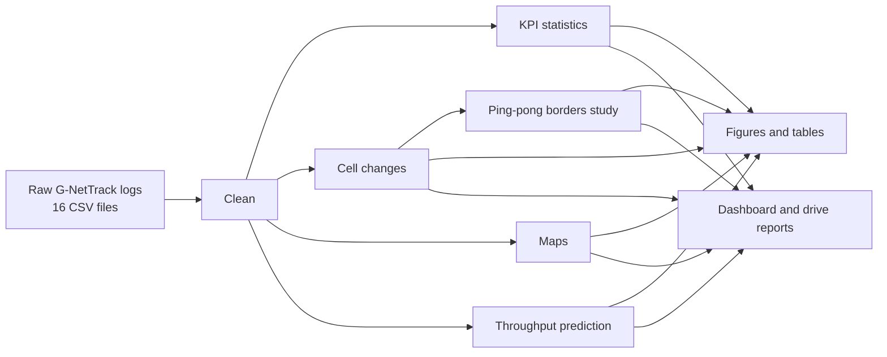

## Main findings

1. **`CellID` in the log is not the cell.** It is only the cell number inside a site. The log has 27 `CellID` values but 111 real cells (`RAWCELLID`). Tracking `CellID` alone misses 44 changes between two sites that reuse the same number.
2. **5G gives 2.3 times the median downlink of LTE** (15.9 vs 6.8 Mbps), with a long tail: the best 10% of 5G samples are above 157 Mbps.
3. **In "5G" rows the logged CQI and SNR do not explain throughput** (rank correlation 0.02 for CQI, against 0.27 on LTE). The network is non-standalone: these KPIs appear to describe the LTE anchor cell, not the NR carrier.
4. **The serving cell changes 1.5 times per minute, with 148 ping-pong round trips** (out to a cell and back within 5 seconds). 36% of all changes belong to such a round trip.
5. **Around an isolated cell change the throughput is about 30% lower for a few seconds** (95% interval 5% to 40%). The one clearly expensive event is moving from a 5G cell to an LTE cell: 57% lower at the change, and still 77% lower afterwards.
6. **Ping-pong seems to belong to particular borders, but the evidence rests on very short round trips.** A rule that only knows "this border had a round trip in another drive" separates ping-pong from normal changes better than a 3 dB signal margin (advantage 36 against 13 points; ahead in 9 of 12 drives). But 79 of the 148 round trips last 2 seconds or less and may be effects of the logger. Without them no difference can be shown.
7. **Radio KPIs alone predict throughput poorly** (R² 0.23 on unseen drives). Location lifts it to 0.41 and ten seconds of history to 0.63. What the phone cannot see (cell load, scheduler, bandwidth) matters most.
8. **A random train/test split would have reported R² 0.46 instead of 0.23.** Neighbouring samples of one drive are near copies, so the model must be tested on whole drives it has never seen.

## Results

### 1. Data quality

A drive-test log is never clean. These problems were found in the raw files and are handled in [`drivetest/clean.py`](drivetest/clean.py). No row is deleted; a bad value becomes missing and the rest of the row is kept.

| Problem in the raw log | What the project does |
|---|---|
| `-` written when there is no value | read as missing |
| RSRP = -200 dBm (with RSRQ = -20, SNR = -30 in the same row) | all three set to missing |
| Neighbour RSRQ = 2147483647 or -204 | set to missing (outside the valid range) |
| 3G rows: RSRQ almost always -2, neighbour RSRP always -51 | set to missing; the 3G signal level (RSCP) is kept |
| 3,145 repeated timestamps | kept: they are separate samples that fall in the same second |
| Ping columns 93% empty | dropped |
| One drive starts with a GPS position 4 km away from the next one | removed (stale position from before the GPS lock) |
| Position only updated every 100 m | maps use 100 m bins |
| Speed frozen between two position updates (it never reads 0 at a stop) | not used as a model input |
| 191 rows (0.7%) where the cell identity does not fit the technology | flagged, and left out of the cell and site counts |

The last row needs a word. An LTE cell identity is eNB ID × 256 + cell number; a 3G one is RNC ID × 65536 + cell number. When the phone changes technology, the logger sometimes updates the network mode and the cell identity in different rows, and for those rows the formula fails.

### 2. KPI statistics

| | 5G (NSA) | LTE | 3G |
|---|---|---|---|
| Share of samples | 50.6% | 33.4% | 16.0% |
| Median RSRP (10th percentile) | -83 dBm (-97) | -88 dBm (-104) | RSCP -69 dBm (-89) |
| Median SNR | 4 dB | 3 dB | not logged |
| Median CQI | 12 | 9 | not logged |
| Median downlink | 15.9 Mbps | 6.8 Mbps | 2.5 Mbps |
| 90th percentile downlink | 157 Mbps | 21 Mbps | 8 Mbps |
| Samples below 1 Mbps while downloading | 14.6% | 15.7% | 29.2% |

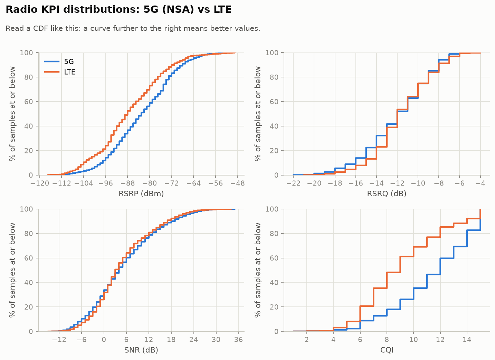

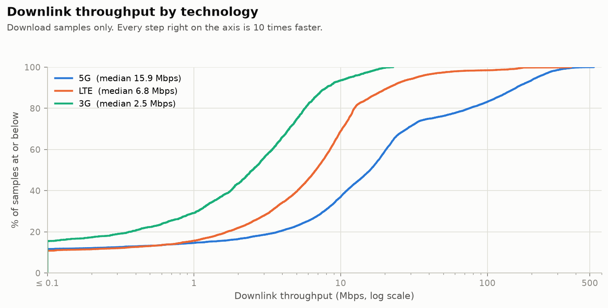

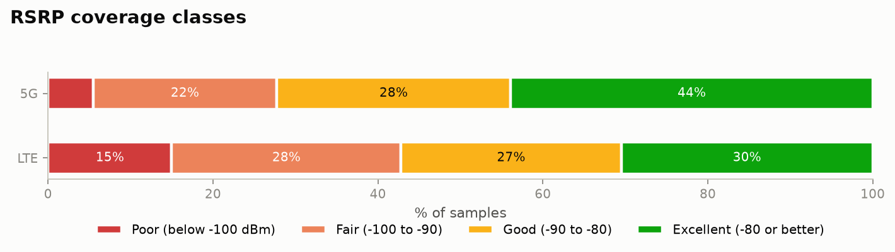

**Link adaptation.** The phone reports CQI and the scheduler picks the modulation and coding from it, so better CQI should mean more throughput. On LTE it does, step by step. On 5G rows there is no steady rise: the median peaks around CQI 11 and then falls again.

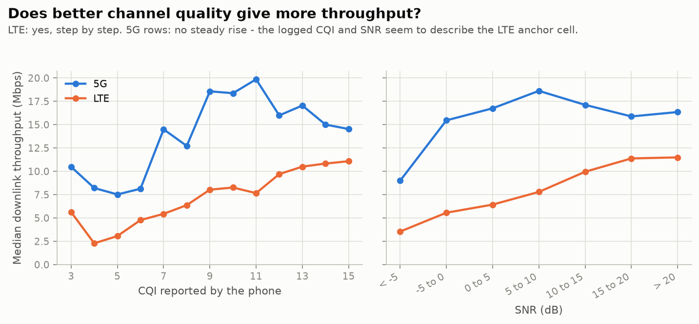

### 3. Serving-cell changes

G-NetTrack is an application-level logger and does not see RRC signalling. So this project detects **serving-cell changes**: moments where the logged cell or technology differs from the previous sample. A change can be a handover, a reselection or a re-establishment; the log cannot tell them apart.

| Kind of change | Count | Part of a ping-pong | Median stay on the old cell |
|---|---|---|---|
| 5G inter-site | 234 | 43% | 8.5 s |
| 5G to LTE | 135 | 36% | 7 s |
| LTE to 5G | 131 | 39% | 17 s |
| LTE inter-site | 91 | 43% | 13 s |
| 5G intra-site | 80 | 25% | 32 s |
| LTE intra-site | 35 | 11% | 33 s |
| Changes involving 3G | 27 | 0% | |
| **All** | **733** | **36%** | 12 s |

**Ping-pong.** A ping-pong is a round trip A → B → A with 5 seconds or less on B. There are 148 of them, and 262 of the 733 changes (36%) are the way out or the way back of one. A chain A → B → A → B → A counts as three round trips; counted as separate episodes there are 114. The share depends on the time limit: 21% with 2 seconds, 28% with 3, 47% with 10.

**The signature of a change.** SNR falls from 4 dB to 0 dB in the last seconds before the change, is at -2 dB on the first two samples on the new cell, and is back at 4 dB four seconds after it. CQI follows: 11, then 9, then 7, then 11 again. At the border the two cells are about equally strong, so whichever one serves, the other is a strong interferer.

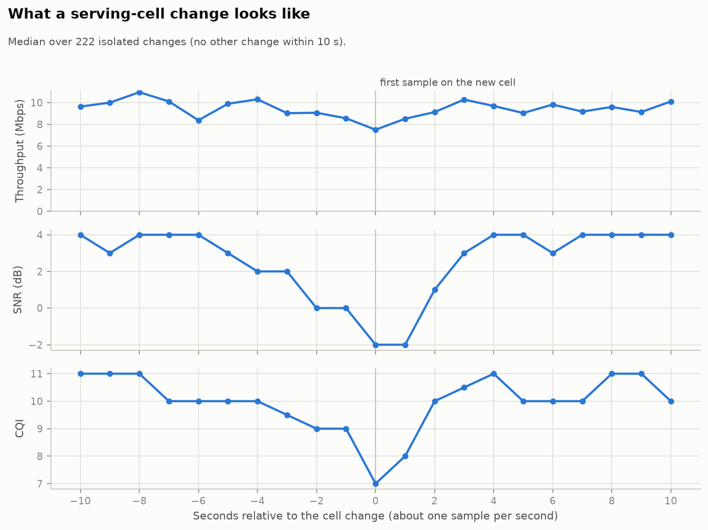

**The cost of a change.** Measured on isolated changes: the 222 changes with no other change within 10 samples. Of these, 201 have download samples before, around and after the change and at least 1 Mbps before it (a ratio to almost zero is meaningless), and those are used. Intervals are 95% bootstrap intervals of the median.

| Kind of change | Events | Drop at the change | Throughput 4 to 10 s after, against before |
|---|---|---|---|
| All isolated changes | 201 | 30.8% (5.1 to 39.7) | -6.8% (-20.7 to 4.1) |
| **5G to LTE** | 38 | **57.2% (33.2 to 76.6)** | **-76.6% (-84.7 to -65.1)** |
| LTE to 5G | 24 | 28.5% (-60.7 to 54.3) | **+198.7% (88.0 to 398.5)** |
| 5G inter-site | 44 | 39.6% (-7.5 to 57.8) | -19.2% (-42.3 to 3.8) |
| 5G intra-site | 43 | 10.5% (-38.5 to 71.6) | +6.3% (-18.7 to 37.4) |
| LTE intra-site | 23 | 14.6% (-24.5 to 37.7) | -5.7% (-25.9 to 17.7) |
| LTE inter-site | 24 | -6.1% (-44.6 to 13.3) | +8.3% (-23.6 to 77.5) |

How to read it: an interval that includes 0 means the data cannot show an effect for that kind. With 23 to 44 events per kind, only the bold values are clear. Taken together the changes do show a dip, and as a control the same calculation at 3,000 random moments gives none (-4.5%).

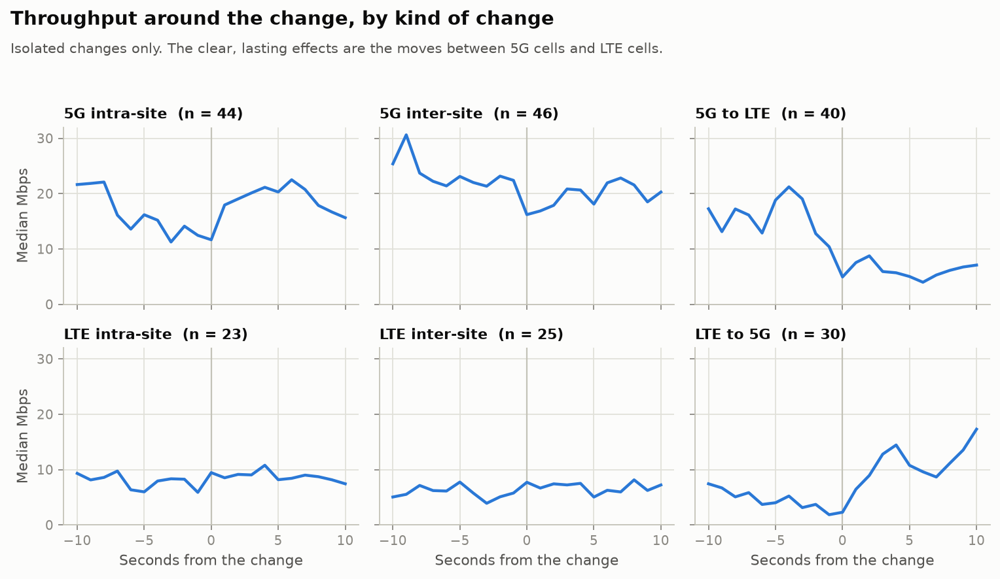

The panel counts in the figure are a little higher than in the table, because the figure draws every isolated change of that kind.

**What "5G to LTE" means here.** The 5G-mode cells and the LTE-mode cells are almost separate sets (49 and 55 cells, 2 in both). A change from 5G to LTE is always a change of cell, and in 127 of 135 cases a change of site. So the large loss is the cost of leaving the 5G-capable cells, not of a 5G carrier being switched off on the same cell.

**Why this matters for RAN traffic control.** Handover parameters (A3 offset, hysteresis, time-to-trigger) decide when a change happens. Margins that are too small give ping-pong; margins that are too large give radio link failures. On these routes the two things to look at first are the site borders, where most ping-pong happens, and the edge of the 5G layer, because falling back to an LTE cell is the one change with a clear and lasting cost. The next section tests whether the ping-pong belongs to particular borders.

### 4. Does ping-pong belong to particular borders?

A third of the cell changes are part of a ping-pong. Before anyone tunes a network for that, there is a simpler question: **what tells a ping-pong apart from a normal change?** If it is the signal gain (the new cell is hardly stronger than the old one), a bigger handover margin would be the place to look. If it is the border (the same pairs of cells again and again), single cell pairs would be.

[`drivetest/tuning.py`](drivetest/tuning.py) writes each idea as a rule. A rule says for every change "I would act on this one", and it is good when it acts on many round trips and on few normal changes. The rules are scored on the 705 changes between LTE and 5G cells that have an RSRP value on both sides: 148 starts of a round trip, 443 normal changes, and 114 that are only the way back of a round trip (those count in neither group).

* **Margin rule:** act on every change whose RSRP gain (new cell minus old cell) is below 3 dB.
* **Border rule:** act at every border that had a round trip *in another drive*. A drive never teaches itself; that would be checking the answer with the answer.
* **Road only (control):** act at every border that another drive also crossed. This rule knows which roads are driven often and nothing about ping-pong. The border rule has to beat it. Otherwise it only knows the roads.

| Rule | Acts on round trips | Also acts on normal changes | Advantage in points (95% interval) |
|---|---|---|---|
| Margin rule | 101 of 148 (68%) | 245 of 443 (55%) | 12.9 (3.9 to 23.4) |
| **Border rule** | 112 of 148 (76%) | 176 of 443 (40%) | **35.9 (20.0 to 38.6)** |
| Road only | 126 of 148 (85%) | 319 of 443 (72%) | 13.1 (3.1 to 21.9) |
| Border rule minus margin rule | | | 23.0 (0.5 to 30.5) |
| Border rule minus road only | | | 22.8 (8.2 to 26.8) |

The advantage is the first percentage minus the second; zero means a rule cannot tell the two apart. The intervals come from a bootstrap over drives that repeats the whole procedure in every draw, including the choice of borders. A draw holds fewer different drives than the real data, so the border rule knows fewer borders there. That is why its interval reaches further down than up.

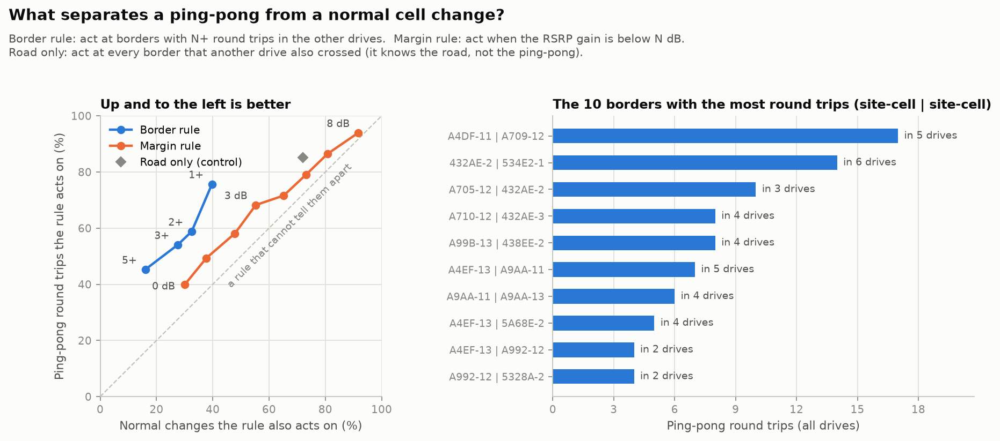

**What it shows, with all round trips:**

* **The border says more than the signal gain.** The border rule is 23 points ahead of the margin rule, and it is ahead in 9 of the 12 drives that have round trips. The lower end of the interval is close to zero (0.5), so this is likely, not certain.
* **It is not only road knowledge.** The border rule is also 23 points ahead of the road-only rule (8 to 27).
* **Ping-pong is concentrated.** The drives crossed 182 borders. Only 48 ever had a round trip, and the 8 worst carry 51% of all round trips, against 30% of all changes.
* **The signal gain says little here.** A 3 dB margin has to touch 55% of the normal changes to reach 68% of the round trips. And 30% of the normal changes go to a cell that measures weaker: either the logged values are too coarse to trust at this level, or this network does not simply pick the strongest cell (frequency priority, load or the 5G anchor may decide). The log cannot say which.

**The catch: very short round trips.** 79 of the 148 round trips last 2 seconds or less. That is close to how often the logger refreshes its radio values, so they may be reporting effects and not real handovers. With those round trips removed (both legs), 56 remain to score, because some longer round trips are chained to a short one. The picture is then no longer clear:

| Without the short round trips | Advantage in points (95% interval) |
|---|---|
| Margin rule | 9.0 (-1.7 to 23.3) |
| Border rule | 17.5 (-5.1 to 26.2) |
| Border rule minus margin rule | 8.5 (-12.0 to 14.7) |

Every interval includes zero. So the result stands or falls with the short round trips. If they are real handovers, ping-pong on these routes belongs to a small set of borders. If they are logger effects, this log cannot show a difference between the rules.

| Border (site-cell \| site-cell) | Kind | Changes | Round trips | Drives with a round trip |
|---|---|---|---|---|
| A4DF-11 \| A709-12 | 5G inter-site | 45 | 17 | 5 of 5 |
| 432AE-2 \| 534E2-1 | LTE inter-site | 34 | 14 | 6 of 6 |
| A705-12 \| 432AE-2 | between 5G and LTE | 22 | 10 | 3 of 4 |
| A710-12 \| 432AE-3 | between 5G and LTE | 26 | 8 | 4 of 8 |
| A99B-13 \| 438EE-2 | between 5G and LTE | 21 | 8 | 4 of 6 |

**Why this matters for RAN traffic control.** The table is a list of where to look first, not a tuning recommendation. In the network the question could be settled with counters per cell pair: handover attempts, ping-pong, and handovers that came too late or too early. That is the data mobility robustness optimisation (MRO) works on. Its main targets are handovers that are too late, too early or to the wrong cell; ping-pong is the opposite failure, which a fix must not create. Hysteresis, A3 offset and time-to-trigger are set in the report configuration and act on all neighbours of a carrier. The cell individual offset acts on one neighbour cell, in one direction. If ping-pong really sits on a few borders, that per-neighbour setting is the natural candidate. This study cannot show that it would work: a rule here is information, not a parameter, and time-to-trigger and measurement filtering, the usual first tools against very short ping-pong, cannot be tested with one sample per second. The full list of borders is in [`results/ping_pong_borders.csv`](results/ping_pong_borders.csv).

### 5. Maps

The same roads were driven many times, so samples are grouped in 100 m road bins and each bin shows the median over all drives. A weak spot counts only if its RSRP comes from at least two different drives.

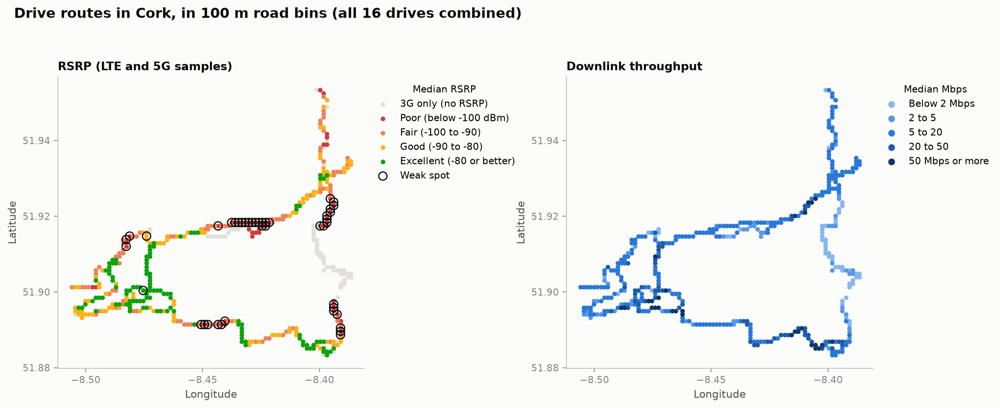

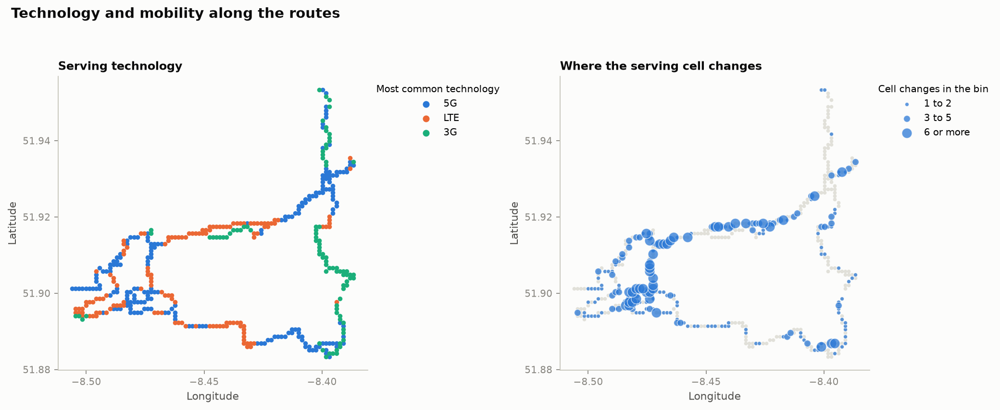

Two kinds of weak spot are separated because the fix is different:

* **Weak coverage, 41 bins:** median RSRP below -100 dBm. Fix: tilt, power, or a new site.
* **Low throughput with good coverage, 2 bins:** RSRP of -90 dBm or better but under 2 Mbps. Fix: look at interference or load, not coverage.

An interactive version with switchable layers (RSRP, throughput, technology, cell changes, ping-pong round trips, weak spots) is on the [live dashboard](https://shaibu-github.github.io/5g-drive-test-kpi-analyzer/) and in [`figures/interactive_map.html`](figures/interactive_map.html). A screenshot:

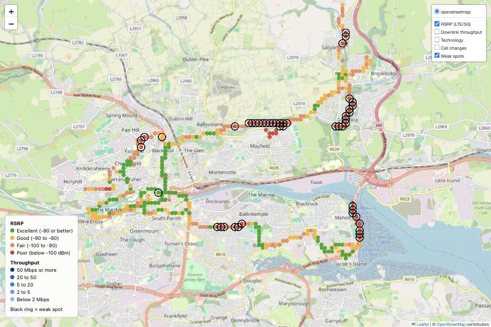

*Map data © OpenStreetMap contributors.*

### 6. Throughput prediction

Goal: predict the mean downlink throughput of a 10-second window from what the phone measures. Three models are compared: linear regression, gradient boosting (both scikit-learn) and a small neural network (PyTorch). Each one is tested on drives it has never seen (5-fold cross-validation grouped by drive). The data is 2,400 windows from the 15 drives that have LTE or 5G samples.

| Inputs | Linear regression | Gradient boosting | Neural network |
|---|---|---|---|
| Technology only (5G or LTE) | 0.18 | 0.19 | 0.19 |
| Radio KPIs | 0.24 | 0.23 | 0.22 |
| Radio KPIs + location | 0.35 | **0.41** | 0.35 |
| Radio KPIs + location + previous 10 s of throughput | 0.53 | **0.63** | 0.60 |

Values are R² on log throughput. Baselines without machine learning: median of the training drives -0.09; persistence ("the next 10 seconds equal the last 10") 0.56, scored on the 2,386 windows that have a previous window.

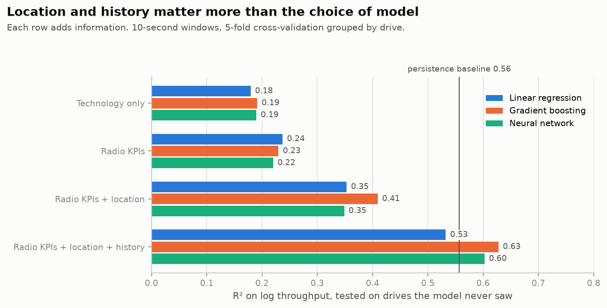

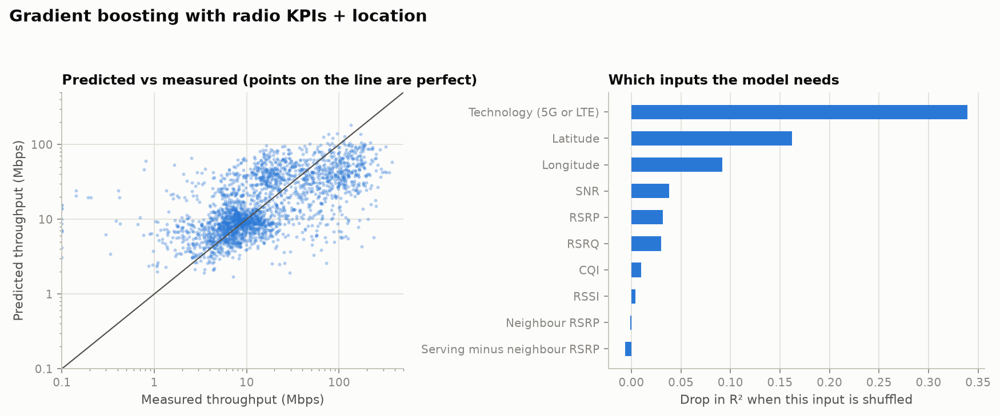

What the comparison shows:

* **Location and history move the score; radio KPIs barely do.** Technology alone gives 0.19 and all radio KPIs together only 0.23. Location adds about 0.18 and history another 0.22. Location stands for things the phone cannot measure: which cells serve that road, their bandwidth and their load.
* **The score depends a lot on which drives are tested.** For gradient boosting on radio KPIs the five folds give 0.40, 0.28, 0.24, -0.63 and 0.06. So differences of a few hundredths, such as 0.19 against 0.23, are noise.
* **Model choice matters less than the inputs.** The three models are within 0.10 of each other on every row. Gradient boosting is ahead once location is added.
* **With history, only two models beat the simple baseline.** Gradient boosting (0.63) and the neural network (0.60) are above persistence (0.56); linear regression (0.53) is below it.
* **The neural network does not beat gradient boosting** on 2,400 rows of tabular data. That is the usual result, and a reason to always keep a simple baseline.
* **Uplink bitrate is deliberately not an input.** During a download it carries the TCP acknowledgements, so it is a result of the downlink (rank correlation 0.78 on 5G rows and 0.86 on LTE rows). Using it would leak the answer.
* **Split by drive, not at random.** The same gradient-boosting model with the same inputs scores R² 0.46 with a random split and 0.23 with a drive split. The second number is the honest one.

### 7. Dashboard and drive reports

The pipeline also writes the results as web pages into [`docs/`](docs/), which GitHub Pages serves as the **[live dashboard](https://shaibu-github.github.io/5g-drive-test-kpi-analyzer/)**: one page for all drives and one page per drive.

Every page is the same template, [`drivetest/templates/report.html`](drivetest/templates/report.html), filled in by [`drivetest/report.py`](drivetest/report.py): headline numbers, interactive charts with the numbers behind each chart, tables and the map. A drive page starts with the classic drive-test view: RSRP, SNR and throughput along the drive, coloured by serving technology, with every cell change marked.

[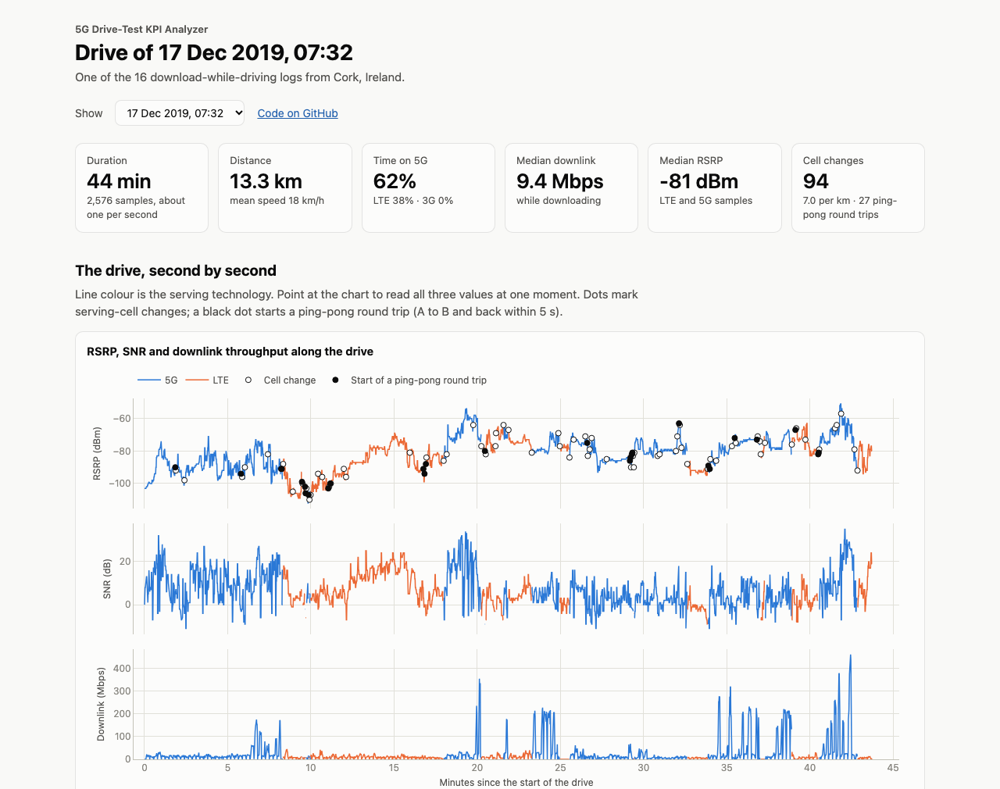](https://shaibu-github.github.io/5g-drive-test-kpi-analyzer/drives/2019.12.17_07.32.39.html)

Because it is a template, the tool can report on a new drive. Give it a G-NetTrack Pro log file with the same columns as the dataset:

```bash
python -m drivetest report my_log.csv      # writes my_log_report.html
```

This was tried on the logs of this dataset and on small hand-made logs (without GPS, without LTE, with missing rows). A log with another network mode, such as 2G or 5G standalone, stops with a message that names the mode.

## How to run it

**In the browser:** click the Colab badge at the top and choose *Runtime → Run all*. The notebook downloads the code and the dataset by itself.

**On your computer** (Python 3.10 or newer):

```bash
git clone https://github.com/Shaibu-github/5g-drive-test-kpi-analyzer.git
cd 5g-drive-test-kpi-analyzer
pip install -r requirements.txt
python -m drivetest      # downloads the data, writes figures/, results/ and the dashboard in docs/
python -m pytest         # 93 tests, no dataset needed
```

The full pipeline takes under a minute on a laptop. Results are reproducible: seeds are fixed. The analysis tables are the same on older library versions (checked with Python 3.11, pandas 2.2, scikit-learn 1.6 and Plotly 5.24); model scores can differ by up to about 0.01. The tests also run on GitHub on every push, on Python 3.11 and 3.12.

## Project structure

```
drivetest/
    data.py        download the dataset, load the raw logs
    clean.py       the cleaning rules
    kpi.py         KPI statistics per technology
    handover.py    serving-cell changes, ping-pong, throughput dip
    tuning.py      does ping-pong belong to particular borders? three rules, scored on unseen drives
    maps.py        100 m road bins, weak spots, interactive map
    model.py       10-second windows, three models, drive-grouped evaluation
    plots.py       every figure of this report
    charts.py      the interactive charts of the dashboard
    report.py      fills the page template for one drive or for all drives
    templates/     report.html, the one page template
    style.py       the colours shared by figures, maps and charts
    pipeline.py    runs everything: python -m drivetest
tests/             93 unit tests on small hand-made logs
drive_test_analysis.ipynb    the analysis as a notebook, with explanations
figures/           figures of this README (made by the pipeline; the three previews are screenshots)
results/           result tables as CSV, and summary.json
docs/              the dashboard (made by the pipeline, served by GitHub Pages)
.github/workflows/ runs the tests on every push
```

## Limits

* One operator, one city, one phone model, winter 2019/20. The numbers describe these routes, not 5G in general.
* Application-level log: no RRC signalling, no cell load, no NR-specific KPIs. Cell changes are detected from the log, and real ping-pong handovers cannot be separated from a serving cell that is simply reported unstably. In 78 of the 148 round trips the stay on the second cell is exactly 2 seconds, close to how often the logger refreshes its radio values, so some of them may be reporting effects.
* The statement that 5G rows carry LTE-anchor KPIs is an inference from the data (the cell identity in those rows is a 28-bit LTE identity, and CQI does not track throughput). The log does not state it.
* Where the logger updates network mode and cell identity in different rows, one real change can be logged as two. 8 of the 733 changes sit next to such a row.
* The cost of a cell change is measured on 201 events, and on 23 to 44 per kind. The intervals in the table are wide; only the moves between 5G and LTE cells stand out clearly.
* The border study (section 4) is not a simulation of the network. "Acts on" means a rule would treat that change differently. A stricter setting may only delay a change, and it raises the risk of a late handover; the log has no radio link failures, so that cost cannot be measured here.
* The RSRP gain of a change comes from one-second application-level values with 1 dB steps, and the log does not give the frequency of a cell. So the margin rule is judged on a blurred value: the network, which sees the real measurement reports, may separate ping-pong better with a margin than this log can show. Between two carriers a margin on RSRP means little.
* The "other drives" of the border rule include later drives. The study tests whether ping-pong belongs to a border, not whether it can be forecast.
* Position is updated only every 100 m, so locations are accurate to about one bin.

## Dataset, citation and licence

The dataset is **not** stored in this repository. The code downloads it from the authors' repository, [uccmisl/5Gdataset](https://github.com/uccmisl/5Gdataset), which is published under the GPL-3.0 licence. This project uses the `Download/Driving` logs.

> D. Raca, D. Leahy, C. J. Sreenan and J. J. Quinlan. *Beyond Throughput, The Next Generation: A 5G Dataset with Channel and Context Metrics.* ACM Multimedia Systems Conference (MMSys), Istanbul, Turkey, June 8-11, 2020.

The code, figures and tables of this project are released under the [GPL-3.0 licence](LICENSE), the same licence as the dataset they are derived from.
